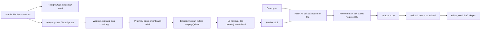

# Keputusan teknis RuangRPP

11 Oktober 2026. Semua pilihan di bawah adalah rekomendasi untuk disepakati, bukan teknologi yang sudah diimplementasikan. Pengguna mengenal Next.js, FastAPI, PostgreSQL, Qdrant, Docker, VPS dan Vercel; menginginkan LLM berbayar yang dapat diganti penyedia.

## 1. Pilihan utama dan trade-off

| Keputusan | Pilihan dan konsekuensi | Rekomendasi awal / kapan diputuskan |
|---|---|---|
| Web/API | Next.js + FastAPI memisahkan UI dan pemrosesan Python, tetapi memerlukan kontrak API, auth dan pengaturan lintas origin. Next.js saja mengurangi layanan tetapi memindahkan ingest ke ekosistem JavaScript | Next.js + FastAPI sesuai pengalaman pengguna; final tahap 3 |
| Database transaksi | PostgreSQL menyimpan akun terkait, metadata, status, job, draf dan versi; file biner tidak perlu masuk kolom database | PostgreSQL; skema dan migrasi tahap 3 |
| Vector search | Qdrant punya filter payload; perlu sinkronisasi dengan PostgreSQL. pgvector menyatukan vektor dan metadata dalam PostgreSQL sehingga operasi lebih sederhana | Qdrant kandidat utama sesuai pengalaman; bandingkan biaya/RAM/operasi dengan pgvector sebelum tahap 5 |
| Auth | Layanan terkelola mempercepat pemulihan akun dan pengelolaan sesi; auth berbasis pustaka di server memberi kendali tetapi menambah tanggung jawab sesi, reset, email dan keamanan | Satu penerbit identitas saja; backend memverifikasi sesi/token dan peran. Pilih tahap 3, jangan merancang kriptografi sendiri |
| Penyimpanan | Direktori/volume privat di VPS sederhana tetapi butuh backup di lokasi lain. Object storage memudahkan pemisahan file dan layanan tetapi menambah biaya/konfigurasi | Volume privat untuk eksperimen lokal; object storage atau volume + backup untuk pilot, keputusan sebelum deployment |
| Ingest | Proses panjang langsung dari permintaan web mudah putus. Worker terpisah dengan job tersimpan memungkinkan retry | Worker Python terpisah; MVP dapat memakai tabel job PostgreSQL dengan penguncian/lease. Redis/antrian tambahan hanya jika dibutuhkan |
| LLM | Satu SDK di banyak tempat sulit dipindah. Adapter per penyedia menjaga kontrak aplikasi | Adapter server; model/penyedia dapat dikonfigurasi admin. Tidak menganggap semua API kompatibel |
| Embedding | API menekan beban VPS tetapi mengirim teks ke penyedia dan menimbulkan biaya. Model lokal memberi kendali tetapi membutuhkan RAM/CPU dan pemeriksaan lisensi model | Benchmark 1–2 kandidat bahasa Indonesia; pilih satu model embedding awal, terpisah dari LLM |
| Hosting | Semua layanan di VPS menyederhanakan domain/jaringan, tetapi satu mesin menjadi titik kegagalan. Next.js di Vercel + API/worker di VPS memisahkan deployment tetapi menambah origin/cookie/jaringan | Mulai lokal dengan Docker; pilih pilot berdasarkan anggaran dan kemampuan operasi |
| Ekspor | DOCX mudah diedit guru; PDF mempertahankan tampilan. Dua jalur render perlu QA tabel, font, dan halaman | Satu model dokumen terstruktur sebagai sumber keduanya; rilis masing-masing setelah lolos QA |

Dokumentasi kemampuan yang diperiksa: [Next.js App Router](https://nextjs.org/docs/app), [FastAPI dalam Docker](https://fastapi.tiangolo.com/deployment/docker/), [filter Qdrant](https://qdrant.tech/documentation/search/filtering/), [pgvector](https://github.com/pgvector/pgvector), [contoh auth terkelola Supabase](https://supabase.com/docs/guides/auth), dan [batas Vercel Functions](https://vercel.com/docs/functions/limitations). Pilihan paket, versi perangkat lunak dan harga belum ditetapkan; periksa lagi sebelum instalasi/pembelian. Rekomendasi operasional tabel adalah penilaian arsitektur, bukan janji biaya dari vendor.

## 2. RAG secara praktis

RAG berarti mencari potongan sumber yang relevan, memasukkannya sebagai konteks, lalu meminta model menulis berdasarkan konteks itu. Embedding adalah representasi numerik untuk pencarian kemiripan; ia tidak melatih ulang LLM dan tidak membuktikan isi benar. Kemiripan semantik harus dibatasi oleh kurikulum, mapel, fase, versi, dan izin.

## 3. Kontrak data yang perlu dirancang

- `documents` dan `document_versions`: identitas stabil, hash file, sumber URL, status izin/konten/ekstraksi, masa berlaku, relasi pengganti versi, pemilik dan jejak pemeriksaan.
- `document_scopes`: banyak baris cakupan untuk satu file; kurikulum, mapel/varian, fase/kelas/wilayah dan batas bagian/halaman. Jangan meneruskan semua tag mapel file gabungan ke setiap chunk.
- `chunks`: ID stabil dalam versi, teks, heading, lokasi asli, tipe sumber, scope khusus chunk, versi extractor/chunker dan hash teks.
- `index_versions` dan `ingestion_jobs`: model embedding, dimensi, status pekerjaan, retry terbatas, pesan kegagalan, indeks aktif. Vektor berada di Qdrant, isi dan status otoritatif berada di PostgreSQL.
- `templates`: komponen/schema dan versi persetujuan guru; jangan mengunci format semua sekolah secara permanen.
- `drafts`, `draft_versions`, `generation_runs`, `citations`: konten terstruktur, pemilik, versi template, provider/model/prompt, daftar chunk yang benar-benar digunakan, biaya/latensi bila tersedia. Simpan perubahan guru terpisah dari keluaran awal.
- `support_scopes`: kombinasi kurikulum/mapel/varian/fase/kelas/wilayah, bukti sumber, hasil uji dan status dukungan. Sumber aktif belum otomatis berarti semua kombinasi mapelnya siap.

Excel tetap menjadi inventaris utama pengumpulan. Setelah admin dibangun, tentukan perpindahan otoritas: impor awal tervalidasi ke PostgreSQL, kemudian Excel menjadi ekspor/inventaris pengumpulan yang direkonsiliasi. Hindari dua tempat yang bisa saling menimpa status tanpa aturan. Multi-nilai Excel dipisah titik koma dan dinormalisasi saat impor.

## 4. Alur ingest dan aktivasi

1. Unggah oleh admin; periksa ekstensi, signature/MIME, ukuran dan hash. Batas awal ukuran/jumlah halaman ditetapkan setelah sampel nyata. Sanitasi nama file dan simpan asli tanpa perubahan.
2. Simpan metadata dan izin. Dokumen meragukan dikarantina; jangan kirim ke embedding/LLM eksternal sebelum izin dan kebijakan data sesuai.
3. Ekstrak PDF digital dan DOCX. Jika teks terlalu sedikit/acak, tandai perlu OCR/tinjauan. OCR terpilih adalah pekerjaan terpisah, bukan kewajiban semua scan berhasil.
4. Pratinjau per bagian dengan teks asli yang dapat dibandingkan. Simpan indeks halaman PDF mulai 1 terpisah dari nomor halaman tercetak. DOCX memakai heading/paragraf/tabel karena pagination berubah.
5. Chunk berdasarkan heading, mapel dan fase. Kandidat awal 400–800 token dengan overlap kecil untuk teks naratif adalah parameter eksperimen, bukan standar kurikulum. Jangan membelah tabel/CP sehingga konteks hilang. Aturan CP dapat memakai chunk lebih utuh.
6. Hanya bagian relevan yang lolos pemeriksaan dibuat embedding. File asli tetap utuh. Catat model, dimensi dan normalisasi.
7. Bangun versi indeks staging; admin melakukan uji retrieval terhadap versi kandidat. Jalur guru hanya melihat sumber aktif.
8. Aktifkan setelah izin, validasi konten, kualitas teks, dan uji retrieval lolos. Catat siapa, kapan, dan cakupan aktivasi.
9. Saat dokumen diganti, buat versi baru dan uji ulang. Versi lama tidak ditimpa. Saat dinonaktifkan, blokir di PostgreSQL terlebih dahulu; filter setiap hasil retrieval melalui status otoritatif sebelum masuk prompt dan sebelum hasil dikirim. Hapus/nonaktifkan vektor serta cache terkait secara asinkron dengan retry. Ini mencegah indeks yang terlambat sinkron membocorkan sumber lama.

Status pemrosesan bukan izin aktivasi. Dokumen “berhasil” masih dapat memiliki izin “perlu ditinjau” dan konten “ditolak”. Draf lama menyimpan riwayat rujukan; jika rujukan ditarik, tampilkan penanda dan jangan diam-diam mengubah versi draf.

## 5. Retrieval dan keluaran

Filter wajib: versi kurikulum, jenjang, mapel/varian, fase atau scope yang sesuai, sumber aktif, versi indeks aktif dan hak penggunaan untuk lingkungan tersebut. Kelas tidak boleh menjadi filter terlalu sempit jika CP hanya ditentukan pada fase; gunakan pemetaan terverifikasi. Semester bukan filter CP wajib. Panduan umum memiliki scope lintas mapel yang eksplisit.

Ambil CP terkait dan panduan/template secara terkontrol, lalu cari contoh relevan. Awali pencarian semantik berfilter; bandingkan pencarian kata kunci/hybrid jika istilah CP atau topik sering terlewat. Tambahkan reranker hanya bila evaluasi menunjukkan peningkatan sepadan biaya/latensi. Jangan memperlakukan skor similarity sebagai persentase kebenaran.

Prompt menyertakan konteks dengan ID chunk, batas peran sumber, template, dan instruksi menolak kekurangan bukti. Dokumen adalah data, bukan perintah. Keluaran mengikuti schema; server memeriksa semua citation ID terhadap konteks yang dikirim. Keberadaan ID saja tidak membuktikan dukungan klaim: evaluasi guru tetap memeriksa isinya. UI membedakan rujukan CP dari usulan pedagogis AI.

## 6. Penyedia LLM yang dapat diganti

Kontrak adapter yang diusulkan: input pesan/konteks, schema keluaran, batas token, timeout dan ID permintaan; output konten, metadata model, pemakaian bila tersedia, dan kategori kegagalan. Simpan API key hanya di server; konfigurasi URL penyedia lewat allowlist admin agar pengguna tidak dapat mengarahkan server ke alamat sembarang.

Daftar kemampuan harus diverifikasi per penyedia/model: JSON terstruktur, streaming, batas konteks, pelaporan token, retensi/pelatihan data, retry dan ketentuan komersial. Nama model, endpoint dan harga belum dipilih. Sebutan OpenAI/DeepSeek berasal dari preferensi pengguna, bukan klaim kesetaraan fiturnya.

Model generasi dapat diganti tanpa otomatis mengganti embedding. Penggantian embedding memerlukan embedding query yang cocok serta versi indeks baru; jangan campur ruang vektor dua model meski dimensinya sama. Qdrant mengatur dimensi dan metrik vektor dalam collection; desain migrasi harus mengikuti model yang dipilih. [Dokumentasi collection](https://qdrant.tech/documentation/manage-data/collections/).

Fallback penyedia harus eksplisit: jangan diam-diam mengirim dokumen ke penyedia baru dengan kebijakan data berbeda. Uji adapter dengan set kasus yang sama; perubahan provider/model dicatat pada hasil. Retry dibatasi untuk menghindari biaya berulang tanpa kendali.

## 7. Keamanan, biaya dan operasi minimum

API selalu memeriksa pemilik draf dan peran admin. Akses file memakai izin server atau URL sementara; database/Qdrant tidak dibuka langsung ke browser atau internet publik. Rahasia tidak masuk repositori/log. Uji prompt injection, sanitasi hasil editor/ekspor, batas unggah, pembatasan permintaan dan kuota internal. Jangan mengumpulkan identitas siswa untuk MVP.

Catat biaya = hosting + penyimpanan/backup + email autentikasi + token embedding baru/ulang + token input/output generasi + retry + OCR/reranker jika dipakai. Cache harus berisi versi sumber/model/template dan dibatalkan saat sumber berubah. Anggaran nominal, batas per pengguna, region dan retensi data masih terbuka.

Docker membantu konsistensi deployment, tetapi tidak otomatis memberi backup atau keamanan. Sediakan backup PostgreSQL, file asli/olahan, dan indeks atau prosedur rebuild yang diuji. Pekerjaan ingest panjang berada di worker VPS; batas fungsi hosting web perlu diperiksa sesuai paket sebelum memilih arsitektur final.

## 8. Keputusan sebelum mulai aplikasi

Keputusan dipisah menurut waktunya agar pengumpulan sumber tidak menghalangi seluruh pekerjaan:

1. Sebelum fondasi lokal tahap 3B: baseline Next.js + FastAPI + PostgreSQL, struktur proyek dan versi dependensi. Rancangan konkretnya tersedia dalam [paket tahap 3A](TAHAP_3_DESAIN_PRODUK.md).
2. Sebelum autentikasi tahap 3C: penerbit identitas/auth dan mekanisme sesi antarlayanan.
3. Sebelum retrieval tahap 5: acuan/tahun ajaran, hak pemrosesan sumber, pilihan Qdrant versus pgvector serta kandidat embedding dan kapasitas lingkungan.
4. Sebelum generator tahap 6: guru peninjau, template v1, kombinasi uji dan kandidat LLM; periksa API, biaya, hak penggunaan dan kebijakan data saat pemilihan.
5. Sebelum deployment: anggaran bulanan, VPS penuh atau Vercel + VPS, penyimpanan, backup dan region.

Fondasi lokal dapat dikerjakan sebelum seluruh sumber terkumpul, dengan fitur generasi belum tersedia dan tanpa API berbayar. Setelah akun/katalog siap, implementasikan satu alur kecil: unggah satu sumber → ekstraksi → pratinjau, sebelum generator lengkap. Desain tahap 3A tidak mengunci penyedia layanan atau menyatakan prasyarat kurikulum telah terpenuhi.
