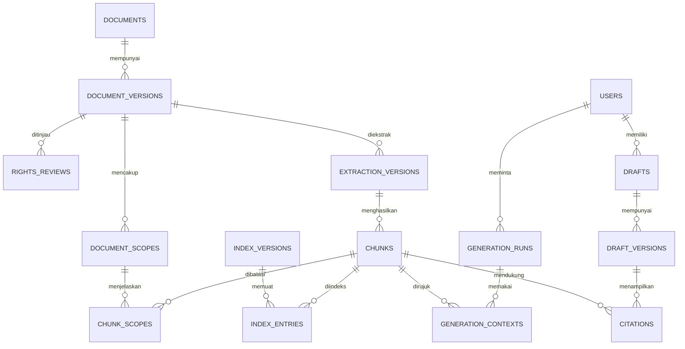

# Tahap 3A — desain database

11 Oktober 2026, versi 0.1. Model logis untuk PostgreSQL; belum berupa migrasi yang dijalankan. Nama kolom merupakan kontrak rancangan. Bagian retrieval dan draf ditambahkan pada tahap terkait, tidak semuanya dibuat pada migrasi pertama.

## 1. Prinsip

PostgreSQL menjadi sumber kebenaran untuk metadata, status, kepemilikan dan versi. File asli berada di penyimpanan privat; vektor berada di Qdrant saat diperlukan. ID internal menggunakan UUID, berbeda dari kode inventaris seperti `RR-CP-MAT-A-001`.

Kolom waktu memakai timestamp dengan zona waktu; simpan instan konsisten dan tampilkan Asia/Jakarta. Tahun terbit yang tidak diketahui bernilai null, bukan tahun saat ini. Untuk data operasional gunakan `created_at`, `updated_at` dan revision integer ketika ada perubahan bersamaan. Isi versi file/draf yang sudah dipakai tidak ditimpa.

Basis data memakai primary key, foreign key, unique, not null dan check untuk batas yang dapat ditegakkan secara lokal. Aturan antarentitas seperti semua prasyarat aktivasi diperiksa di transaksi aplikasi; jangan menganggap CHECK bisa membaca keadaan tabel lain secara aman. [Dokumentasi constraint PostgreSQL](https://www.postgresql.org/docs/current/ddl-constraints.html).

## 2. Entitas fondasi

| Entitas | Kolom utama | Aturan dan fungsi |
|---|---|---|
| `users` | id, auth_issuer, auth_subject, display_name, role, disabled_at | Pasangan issuer/subject unik; role guru/admin; email bukan identitas permanen. Detail akun/password tetap mengikuti penyedia auth |
| `curriculum_versions` | id, code, label, school_year, verification_status, evidence_ref | Kode unik; entri belum diverifikasi tidak menjadi pilihan generator; tidak melakukan seed CP resmi tanpa bukti |
| `subjects` | id, code, label, parent_id, variant_kind | Kategori umum dan varian spesifik; parent opsional. Kategori Agama/Seni tidak dianggap varian yang bisa langsung digenerasikan |
| `support_scopes` | id, curriculum_version_id, subject_id, grade, phase, region_code, status, reviewer, reviewed_at, evidence_ref, revision | Satu kombinasi sekolah sasaran; grade 1–6; fase mengikuti pemetaan terverifikasi. Wilayah eksplisit untuk mulok; status tidak otomatis berarti berlaku nasional |
| `documents` | id, title, category, publisher, source_url, created_by, revision | Identitas logis suatu dokumen; satu dokumen dapat memiliki beberapa versi file |
| `document_versions` | id, document_id, inventory_id, version_number, publication_year, edition_label, original_filename, local_filename, storage_key, sha256, mime_type, size_bytes, metadata_snapshot, processing_status, text_quality, validation_status, activation_status, rights_revision, revision | Inventory ID unik per file sesuai Excel; satu versi mengikat asli dan metadata saat ditinjau; default nonaktif |
| `rights_reviews` | id, document_version_id, revision_number, status, allowed_uses, evidence_ref, reviewer_id, reviewed_at, notes | Versi pemeriksaan tidak ditimpa; pisahkan izin indeks, kirim ke penyedia, komersial dan distribusi file asli. Tidak jelas berarti belum diizinkan |
| `audit_events` | id, actor_id, action, entity_type, entity_id, changed_fields, occurred_at, request_id | Jejak perubahan, tanpa API key atau teks sensitif berlebihan. Tidak dapat diedit lewat UI biasa |

Pasangan `(document_id, version_number)` unik. Hash diperiksa server setelah unggah; client tidak menentukan hasil hash. Duplikasi byte mengembalikan referensi versi yang sudah ada kepada admin, bukan membuat file baru. Bila dokumen identik dikaitkan ke banyak kebutuhan, gunakan relasi cakupan. Hak penggunaan tetap diperiksa meskipun byte identik.

Untuk `support_scopes`, definisikan key unik yang memperlakukan wilayah kosong sebagai nilai tidak berwilayah, bukan membiarkan beberapa baris “sama” karena null. Jangan memakai nilai wilayah kosong sebagai wildcard untuk sumber lokal. Detail constraint final dibuat saat migrasi.

`metadata_snapshot` menyimpan keterangan tambahan/asal impor; kolom yang dipakai filter dan izin tetap terstruktur. Daftar string bertitik koma di Excel dinormalisasi saat impor, bukan dijadikan mekanisme query database.

## 3. Cakupan isi dan penyiapan sumber

| Entitas | Kolom utama | Aturan |
|---|---|---|
| `document_scopes` | id, document_version_id, curriculum_version_id, subject_id, phase, grade, region_code, scope_kind, locator, evidence_ref | Banyak cakupan per file. `scope_kind`: specific/general_guidance; null berarti belum diketahui kecuali jenis scope eksplisit mengizinkan umum |
| `ingestion_jobs` | id, document_version_id, stage, status, attempts, lease_until, worker_id, idempotency_key, error_code, created_by | Tahap extract/chunk/embed/index_cleanup; lease mencegah job macet; retry terbatas; ulang tidak menggandakan hasil |
| `extraction_versions` | id, document_version_id, extractor_version, output_key, text_hash, reviewed_by, reviewed_at, quality | Teks olahan terpisah dari file asli; persetujuan hanya berlaku pada hasil ekstraksi tersebut |
| `chunks` | id, extraction_version_id, ordinal, text, locator, chunker_version, text_hash | Satu chunk tidak otomatis memperoleh seluruh tag mapel dalam PDF gabungan |
| `chunk_scopes` | chunk_id, document_scope_id | Banyak relasi bila chunk benar-benar lintas cakupan; kedua objek harus berasal dari versi dokumen yang sama |
| `index_versions` | id, collection_name, embedding_provider, embedding_model, dimensions, metric, configuration_hash, status | Ruang embedding eksplisit; model/dimensi/metrik tidak dicampur diam-diam |
| `index_entries` | index_version_id, chunk_id, point_id, status | Pasangan indeks/chunk unik; hubungan ke point Qdrant untuk rekonsiliasi dan penghapusan |
| `retrieval_evaluations` | id, index_version_id, scope_id, tested_document_versions, rubric_version, results_ref, reviewer_id, outcome, evaluated_at | Bukti uji mengikat versi, bukan label “lulus” yang berlaku selamanya |

Locator berbentuk data terstruktur: `pdf_page_index` mulai 1, `printed_page_label` opsional, `heading_path`, `paragraph_id` atau rentang tabel. Kedua jenis halaman tidak saling menggantikan; jangan mengarang halaman DOCX.

Hak dan status pada payload Qdrant hanya salinan untuk penyaringan awal. Setiap kandidat yang akan dipakai dibaca ulang statusnya dari PostgreSQL. Jika sumber dinonaktifkan, embedding lama tidak boleh tetap menjadi konteks meski vektornya belum dihapus.

## 4. Template dan draf — mulai saat tahap generator/editor

| Entitas | Kolom utama | Aturan |
|---|---|---|
| `template_versions` | id, template_key, version_number, curriculum_version_id, component_schema, status, reviewer_name, review_evidence, reviewed_at | Schema komponen dapat berkembang; hanya approved dipakai generasi |
| `support_requirements` | scope_id, source_role, document_version_id, template_version_id | Menghubungkan CP, panduan, contoh dan template pada cakupan. Peran sumber jelas; referensi template atau dokumen diperiksa sesuai source_role |
| `generation_runs` | id, owner_id, scope_id, template_version_id, input_snapshot, provider_config_version, model, prompt_version, index_version_id, rights_snapshot, status, idempotency_key, usage, error_code | Tercatat sebelum memanggil penyedia; biaya yang tidak dilaporkan tetap null, bukan 0 |
| `generation_contexts` | run_id, chunk_id, rank, retrieval_score, source_version_id | Semua konteks yang dikirim, tidak semuanya otomatis menjadi sitasi |
| `drafts` | id, owner_id, title, current_version_id, revision, created_at, updated_at | Pemilik diambil dari sesi; tidak menerima owner_id dari client |
| `draft_versions` | id, draft_id, version_number, parent_version_id, origin, generation_run_id, template_version_id, content_json, created_by, created_at | Versi immutable; origin generated/teacher_edit. Simpan edit tidak memanggil LLM lagi |
| `citations` | id, draft_version_id, component_id, chunk_id, source_version_id, review_status | Untuk hasil generated, chunk harus ada di konteks run terkait. Edit guru dapat menyalin rujukan dengan status needs_review |

Relasi inti:

Diagram disederhanakan; daftar tabel di atas adalah rujukan untuk relasi tambahan. Pointer `current_version_id` harus menunjuk versi dalam draft yang sama. Simpan versi baru dan pindahkan pointer dalam satu transaksi setelah memeriksa revision. Berkas sumber yang sudah menjadi rujukan tidak dihapus berantai saat dinonaktifkan; riwayat disimpan mengikuti hak akses/retensi yang berlaku.

## 5. Status dan transisi

| Dimensi | Nilai API/database | Makna |
|---|---|---|
| Izin | unreviewed, needs_review, allowed_with_evidence, noncommercial_only, denied | Pisah dari allowed_uses dan bukti; allowed saja tanpa lingkup tidak cukup |
| Pemrosesan | not_started, running, succeeded, failed, needs_review | Succeeded hanya untuk tahap job yang selesai; bukan seluruh pipeline |
| Kualitas teks | unchecked, good, needs_ocr, garbled | Good terikat extraction_version yang diperiksa |
| Validasi isi | unvalidated, valid, needs_revision, rejected | Penilaian kurikulum/pedagogi, bukan izin komersial |
| Aktivasi sumber | inactive, staging, active, suspended | Staging hanya untuk evaluator admin |
| Dukungan cakupan | unsupported, preparing, internal_test, limited, suspended, not_applicable | Limited memerlukan bukti penerapan, paket sumber, template dan evaluasi |
| Job/run | queued, running, succeeded, failed, cancelled | Alasan spesifik pada error_code; kegagalan tidak otomatis menghapus masukan |

API memakai kode tetap; UI dan impor Excel memetakan label bahasa Indonesia ke kode tersebut secara eksplisit. Label yang tidak dikenal ditolak pada pratinjau impor, tidak diubah otomatis menjadi valid.

Aktivasi sumber mensyaratkan seluruh kondisi berikut pada versi yang sama: file tersedia; metadata/cakupan diperiksa; konten valid; teks good; hak pemakaian sesuai lingkungan dan penyedia tujuan; entri indeks siap; uji retrieval versi tersebut lulus. Kesiapan generator juga memerlukan template disetujui dan cakupan limited. Katalog sebaiknya mengembalikan kesiapan efektif beserta alasan, bukan hanya status tersimpan.

Setiap perubahan yang memengaruhi hak, konten, cakupan atau hasil ekstraksi menggugurkan persetujuan yang bergantung padanya. Buat revisi/versi dan minta uji ulang; jangan tetap aktif setelah mengubah teks yang telah diuji. Perubahan ejaan judul tampilan tetap diaudit tetapi tidak perlu membuat embedding baru.

## 6. Impor Excel dan file tim

Pengumpulan masih memakai workbook utama. Impor aplikasi dilakukan sebagai pratinjau: cocokkan header, ID, status, kelas/fase, path dan keberadaan file; tampilkan konflik dan baris bermasalah; baru commit baris yang disetujui. Workbook tidak memberikan hak menetapkan role atau mengaktifkan sumber. Nilai aktivasi impor maksimal diperlakukan sebagai permintaan tinjauan, tidak langsung active.

`inventory_id` mengidentifikasi satu file/versi. `document_id` mengelompokkan versi logis. Relasi “ID dokumen terkait” dari Excel diperiksa admin; tidak semua relasi berarti pengganti versi. Hash dihitung ketika file diterima. Path dari Excel tidak boleh memberi akses membaca file di luar lokasi upload yang diizinkan.

Setelah impor pertama, status operasional aplikasi diperbarui di PostgreSQL. Excel tetap dipakai pengumpulan tambahan dengan proses rekonsiliasi, bukan impor yang menimpa hasil validasi diam-diam. Jangan mengindeks README/PETUNJUK sebagai sumber kurikulum.

## 7. Pengujian wajib ketika skema diimplementasikan

- ID inventaris sama ditolak; unggah byte sama tidak menggandakan file.
- Versi baru tidak mengubah sitasi draf lama.
- Relasi chunk ke scope dokumen berbeda ditolak.
- Cakupan dengan wilayah/varian yang berbeda tidak dianggap setara.
- Menyimpan draf orang lain ditolak meskipun ID valid.
- Dua penyimpanan dari revision sama: hanya satu berhasil, lainnya konflik.
- Sumber suspended tidak lolos walaupun point Qdrant masih ada atau hasil tersimpan dalam cache.
- Mengubah bukti izin/cakupan membatalkan kesiapan sampai pemeriksaan terkait diulang.

Belum ada pengujian database dijalankan karena migrasi dan layanan belum dibuat.
