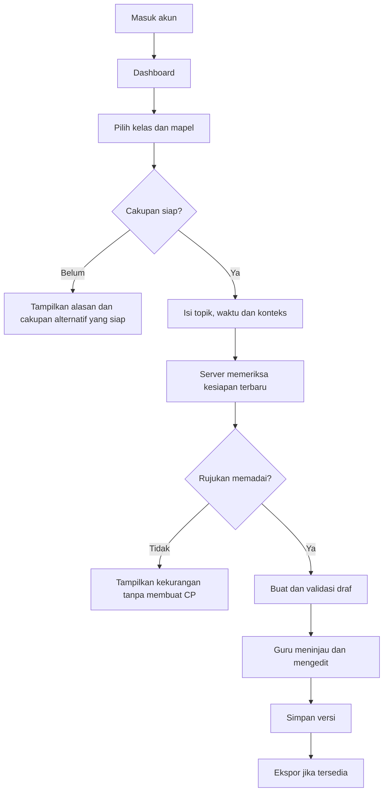
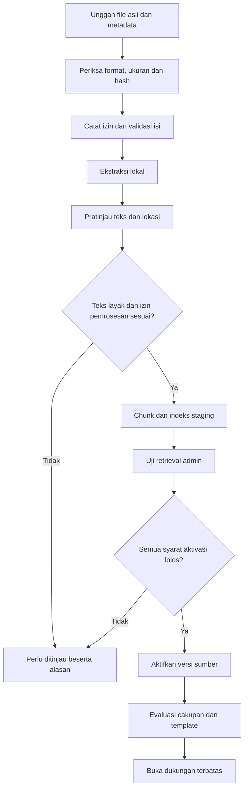

# Tahap 3A — desain produk dan batas implementasi

11 Oktober 2026, versi 0.1. Rancangan untuk ditinjau; belum berupa aplikasi berjalan. Pengumpulan sumber pada tahap 2 tetap berlangsung. Validasi kurikulum dan persetujuan guru pada tahap 1 belum dinyatakan selesai.

## Tujuan langkah ini

Membuat alur guru/admin, struktur data dan kontrak API cukup jelas untuk membangun fondasi kecil. Kita dapat mendesain halaman, akses akun, metadata dan kondisi tanpa data sekarang. Aktivasi sumber, evaluasi retrieval dan generator memerlukan dokumen serta template yang lolos pemeriksaan.

Paket desain ini terdiri dari:

- Dokumen ini: pengalaman pengguna, batas akses dan urutan implementasi.
- [Desain database](TAHAP_3_DATABASE.md): entitas, hubungan, status dan aturan integritas.
- [Kontrak API](TAHAP_3_KONTRAK_API.md): daftar operasi, bentuk data, kegagalan dan pengujian penerimaan.

Tidak ada akun layanan, biaya API, database atau deployment yang dibuat pada langkah desain ini.

## 1. Arah teknologi

Gunakan Next.js untuk web, FastAPI untuk aturan aplikasi, dan PostgreSQL untuk data utama sebagai baseline rancangan berdasarkan pengalaman pengguna. Qdrant tetap kandidat utama pencarian vektor dan mulai diperlukan pada tahap 5. Docker digunakan untuk lingkungan lokal saat implementasi. Ini bukan penggantian stack atau keputusan membeli layanan.

Autentikasi dirancang melalui satu penerbit identitas dengan pustaka/layanan yang terpelihara. Pemilihan penyedia, biaya dan region belum dikunci. FastAPI tetap memeriksa identitas dan izin setiap operasi; menyembunyikan tombol admin saja tidak cukup. Panduan Next.js membedakan autentikasi, sesi dan otorisasi, serta menyarankan pemakaian solusi autentikasi yang sesuai. [Dokumentasi Next.js](https://nextjs.org/docs/app/guides/authentication). FastAPI menyediakan perangkat integrasi keamanan, bukan layanan akun siap pakai. [Dokumentasi FastAPI](https://fastapi.tiangolo.com/tutorial/security/).

Untuk desain awal, browser memakai satu origin web. Next.js meneruskan permintaan aplikasi ke FastAPI dari server dengan identitas terverifikasi. Kredensial API LLM dan embedding tidak pernah masuk browser. Cookie sesi menggunakan pengamanan yang sesuai; operasi perubahan data memeriksa CSRF/origin. Cara penerusan token dan verifikasi final ditetapkan saat penyedia auth dipilih. Jangan membuat login palsu atau header identitas bebas sebagai pengganti auth produksi.

## 2. Peran dan akses

| Pengguna | Dapat melakukan | Batas |
|---|---|---|
| Pengunjung | Membaca halaman utama, status cakupan publik dan masuk akun | Tidak membaca file asli, draf, atau metadata privat |
| Guru | Membuat draf pada cakupan siap, membaca/mengedit draf miliknya, melihat rujukan yang diizinkan | Tidak mengubah status sumber atau membaca draf guru lain |
| Admin | Mengelola katalog dan sumber, mencatat hasil pemeriksaan, menjalankan uji dan mengatur aktivasi | Tidak otomatis mendapat akses isi seluruh draf guru |

Peninjau guru pada MVP dapat memberikan penilaian di luar aplikasi dan admin mencatat bukti, nama serta tanggalnya. Peran reviewer khusus dapat ditambah jika alur nyata membutuhkannya. Jangan mengaku sumber sudah diperiksa guru hanya karena admin menekan tombol.

Akun baru memperoleh peran guru. Peran admin hanya melalui proses pengelola yang tercatat; formulir pendaftaran tidak menerima pilihan peran. Kebijakan akses ini harus sama di UI, API dan pekerjaan latar belakang.

## 3. Daftar halaman dan kondisi utama

| Halaman | Isi dan tindakan | Kondisi kosong/gagal |
|---|---|---|
| `/` | Nama, tagline, penjelasan draf AI, tombol masuk, tautan cakupan | Tidak menampilkan klaim semua mapel siap atau contoh seolah hasil tervalidasi |
| `/cakupan` | Mapel/varian, kelas/fase, acuan dan status dukungan | “Sumber sedang disiapkan” bila belum tersedia; kondisi gagal memuat dibedakan dari belum ada dukungan |
| `/masuk` | Masuk akun; daftar/reset melalui mekanisme auth terpilih | Pesan sesi berakhir atau gagal masuk; isian pengguna tidak dibuang tanpa alasan |
| `/dashboard` | Draf milik guru, waktu perubahan, judul, tombol mulai | “Belum ada draf tersimpan” dan tombol menuju cakupan/generator |
| `/generator` | Form konteks, status kesiapan dan tombol buat draf | Pilihan tidak siap berlabel alasan; tombol buat nonaktif. Masukan tetap tersimpan di halaman saat validasi gagal |
| `/draf/[id]` | Editor, sumber per bagian, simpan, riwayat, ekspor jika siap | Kesalahan menyimpan mempertahankan edit; akses draf orang lain tidak membocorkan judul |
| `/admin/sumber` | Daftar sumber, filter status, unggah, detail | Daftar kosong mengajak unggah; kegagalan API tidak tampil sebagai nol dokumen |
| `/admin/sumber/[id]` | Metadata, file/versi, hasil ekstraksi, pemeriksaan dan riwayat | Alasan gagal/ditahan terlihat; tahap selanjutnya hanya bisa dijalankan jika prasyarat lolos |
| `/admin/cakupan` | Kaitan acuan, mapel/varian, kelas, sumber, template dan hasil evaluasi | Admin dapat melihat kekurangan sebelum suatu cakupan dibuka |

Rute adalah rancangan navigasi, bukan halaman yang telah dibuat. Riwayat dan ekspor dibangun setelah fondasi dan generator stabil, mengikuti roadmap.

## 4. Alur guru



Form yang diusulkan:

| Isian | Wajib | Aturan |
|---|---|---|
| Acuan/tahun ajaran sasaran | Ya pada konfigurasi cakupan | Tampilkan pilihan terverifikasi dari server; tidak meminta guru mengetik nomor CP dari ingatan |
| Kelas | Ya | 1–6; mapel yang berlaku berasal dari matriks, bukan daftar statis seragam |
| Mata pelajaran/varian | Ya | Agama, cabang seni dan bahasa/wilayah mulok harus spesifik bila diperlukan |
| Fase | Ditentukan sistem | Diturunkan dari pemetaan yang disahkan; ditampilkan kepada guru, tidak ditebak dari topik |
| Semester | Jika relevan | Opsional; kosong berbeda dari semester 1; tidak membagi CP otomatis |
| Topik/materi | Ya | Teks singkat; batas awal usulan 200 karakter, bukan standar kurikulum |
| Pertemuan dan durasi | Ya | Jumlah pertemuan dan menit tiap pertemuan positif; total dihitung. Konversi JP hanya jika menit per JP diketahui |
| Konteks/sarana/kebutuhan umum | Opsional | Teks usulan maksimum 2.000 karakter; hindari nama dan identitas siswa |

Usulan batas karakter adalah keputusan produk yang dapat diubah, bukan ketentuan sumber resmi.

Susunan editor: ringkasan identitas di atas; daftar komponen di kiri atau menu lipat pada ponsel; isi komponen di tengah; rujukan terkait pada panel yang dapat dibuka. Jangan menjejalkan seluruh modul dalam satu bidang teks tanpa struktur.

Status simpan harus eksplisit: “Ada perubahan belum disimpan”, “Menyimpan”, “Tersimpan”, atau “Gagal menyimpan”. Mulai dengan tombol simpan manual dan peringatan saat meninggalkan perubahan. Autosave bukan prasyarat milestone awal. Jika tab lain menyimpan versi baru, tampilkan konflik dan pertahankan perubahan lokal.

Referensi membedakan halaman PDF dan nomor tercetak. DOCX menggunakan bagian/paragraf bila tidak ada halaman stabil. Bagian yang diedit guru ditandai “rujukan perlu dicek ulang” karena kutipan hasil generasi tidak otomatis membuktikan teks editan.

## 5. Alur admin



Detail sumber memakai lima bagian: Metadata; File dan versi; Ekstraksi; Pemeriksaan; Riwayat. Empat status berbeda ditampilkan bersama: izin, kualitas teks, validasi konten, pemrosesan. Aktivasi memiliki status sendiri.

Tombol “Aktifkan” menampilkan daftar prasyarat yang belum terpenuhi, bukan hanya pesan umum “gagal”. Menonaktifkan sumber segera memblokir pemakaian baru; pembersihan indeks dapat menyusul. Dukungan cakupan yang bergantung pada sumber itu dihitung ulang sebelum menerima permintaan berikutnya.

## 6. Pesan produk yang disarankan

- Tanpa sumber: “Sumber untuk pilihan ini belum siap. Pilih cakupan yang tersedia atau coba kembali setelah sumber ditinjau.”
- Retrieval kurang: “Kami belum menemukan rujukan yang cukup untuk topik ini. Perjelas topik atau ubah konteks pembelajaran.”
- Header hasil: “Draf pembelajaran — tinjau tujuan, kegiatan, asesmen, dan sumber sebelum digunakan.”
- File duplikat: “File yang sama sudah tercatat. Buka dokumen tersebut untuk memperbarui metadata.”
- Ekstraksi buruk: “Teks belum terbaca dengan baik. Periksa file atau hasil OCR sebelum melanjutkan.”
- Penyedia AI gagal: “Draf belum berhasil dibuat. Masukan Anda tetap tersedia.” Tombol ulang hanya aman setelah status permintaan sebelumnya diketahui.

Label, pesan kesalahan dan indikator fokus harus terbaca tanpa bergantung warna. Form bisa dipakai dengan keyboard. Status memuat jangan menghapus konten yang masih berguna.

## 7. Struktur proyek yang akan dibuat saat implementasi

```text
ruangRPP/
├── apps/
│   └── web/                  Next.js
├── services/
│   └── api/                  FastAPI, modul domain dan migrasi
│       └── app/
│           ├── auth/
│           ├── catalog/
│           ├── sources/
│           ├── drafts/
│           └── jobs/         Worker memakai aturan domain yang sama
├── infra/                    Docker dan konfigurasi lokal
├── tests/                    Pengujian integrasi lintas layanan
├── docs/                     Rancangan dan panduan tim yang sudah ada
├── RUANGRPP_DATA/             Pengumpulan sumber yang sudah ada
└── tools/                    Alat bantu yang sudah ada
```

Ini rencana struktur aplikasi, belum folder/kode aplikasi yang dibuat. Tidak mengubah folder pengumpulan. Worker dapat memakai image Python yang sama dengan API dan perintah proses berbeda. Modul yang belum diperlukan dibuat saat milestonenya dimulai, bukan semuanya sekaligus.

## 8. Milestone kecil setelah rancangan ini

| Milestone | Pekerjaan | Syarat selesai | Bergantung sumber nyata? |
|---|---|---|---|
| 3A — rancangan | Alur, data, kontrak dan kriteria penerimaan | Konsistensi peran, status dan operasi diperiksa; keputusan terbuka dicatat | Tidak |
| 3B — fondasi lokal | Next.js, FastAPI, PostgreSQL, Docker, health/readiness dan halaman awal tanpa data | Lingkungan dapat dijalankan; API membaca database; kegagalan database dilaporkan benar; belum memanggil LLM | Tidak |
| 3C — akun dan katalog | Integrasi auth, peran, katalog, halaman cakupan | Token/sesi tidak sah ditolak; admin dibatasi; katalog kosong tidak membuka generator | Tidak, bisa memakai fixture uji sintetis terpisah |
| 4A — satu file masuk | Unggah, simpan asli, hash, metadata dan status | Berkas duplikat/rusak ditangani; catatan tersimpan; audit jelas | File uji teknis cukup; bukan evaluasi kurikulum |
| 4B — ekstraksi | Ekstraksi lokal dan pratinjau bagian/halaman | Teks dapat dibandingkan file asli; OCR buruk ditandai | Perlu sampel format representatif |
| 5 dan seterusnya | Retrieval, generator, editor dan evaluasi | Ikuti gerbang sumber/template/guru pada roadmap utama | Ya |

Jangan menyebut tahap 3 selesai hanya karena dokumen 3A tersedia. Login, batas akses dan kerangka aplikasi masih harus diimplementasikan dan diuji.

Keputusan sebelum 3B: konfirmasi baseline stack dan rancangan struktur dalam paket ini; pilih versi dependensi saat implementasi. Keputusan sebelum 3C: penerbit identitas dan metode login. Anggaran hosting, model LLM, embedding dan finalisasi format ajar tidak menghalangi 3B, tetapi wajib dituntaskan sebelum fitur terkait dirilis.
